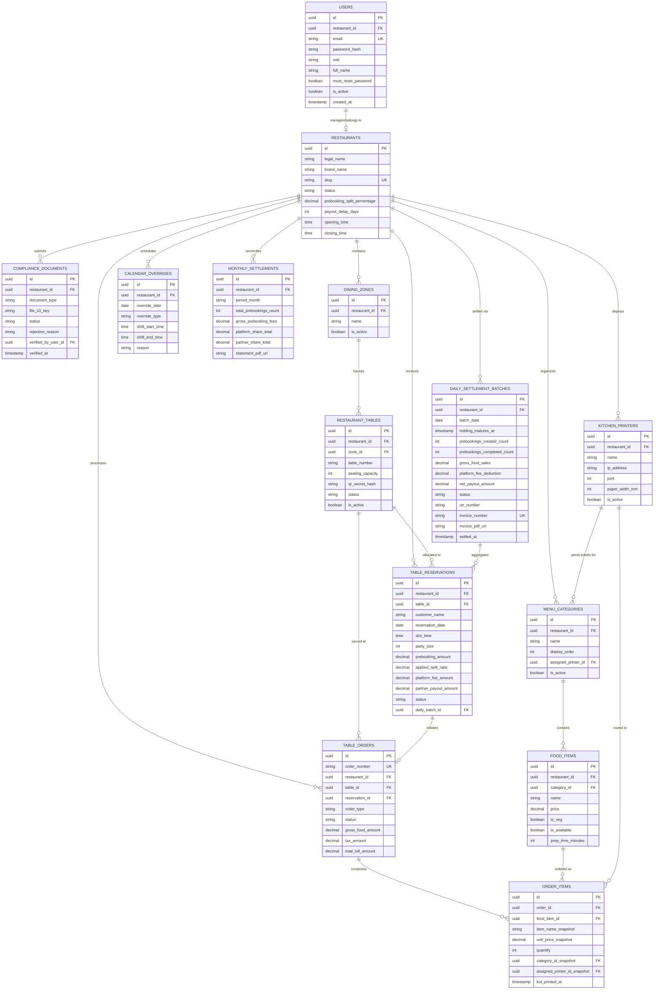
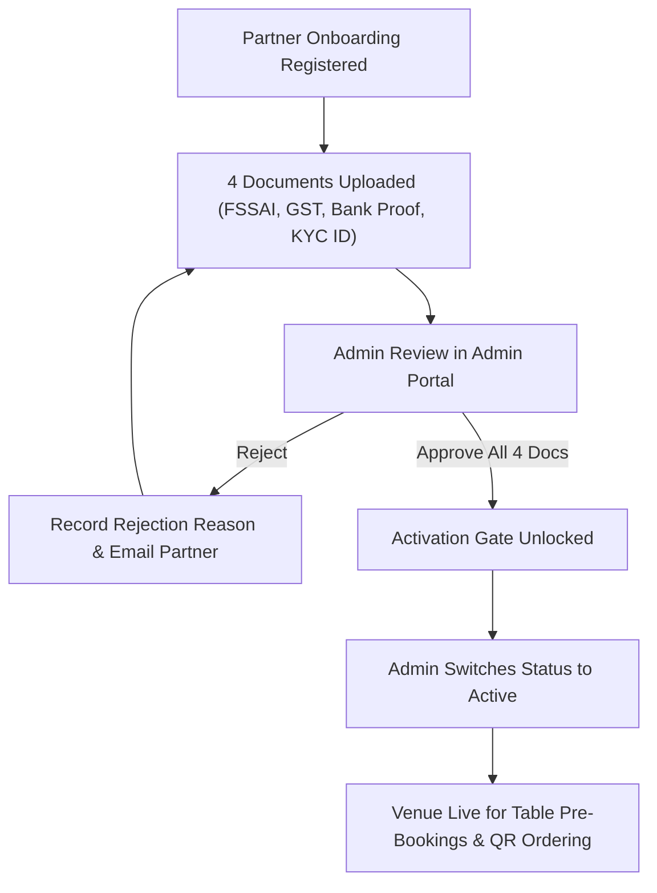
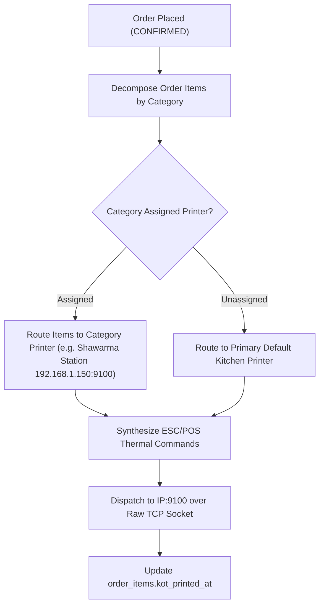
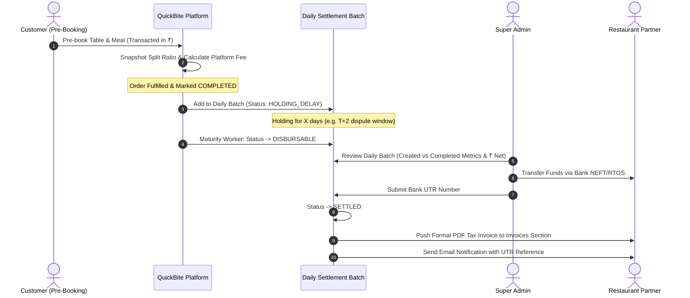

# QuickBite Entity-Relationship (ER) Architecture

This document provides visual architectural diagrams and domain relationship mappings for the **QuickBite** platform database using Mermaid modeling syntax.

---

## 1. Complete Entity-Relationship Diagram

---

## 2. Core Operational Subsystems

### 2.1 Restaurant Onboarding & Compliance Verification Flow

### 2.2 Category-Based KOT Thermal Printing Flow

### 2.3 Delayed Daily Settlement (T+X Days) & Partner Invoice Lifecycle

---

## 3. Financial Invariant Guarantees

1. **Pre-Booking Fee Exclusivity:** The commercial split percentage (`prebooking_split_percentage`) applies strictly to upfront pre-booking customer charges. Spot QR orders and in-venue manual punching incur **0% platform commission**.
2. **Snapshot Immutability:** When a pre-booking occurs, `applied_split_ratio`, `platform_fee_amount`, and `partner_payout_amount` are written to `table_reservations`. Any future change to the restaurant's contract split ratio in the Admin Portal leaves past reservations and statements untouched.
3. **Paise Accuracy:** All columns use `DECIMAL(10, 2)` denominated strictly in Indian Rupees (₹), completely eliminating binary floating-point rounding errors.
