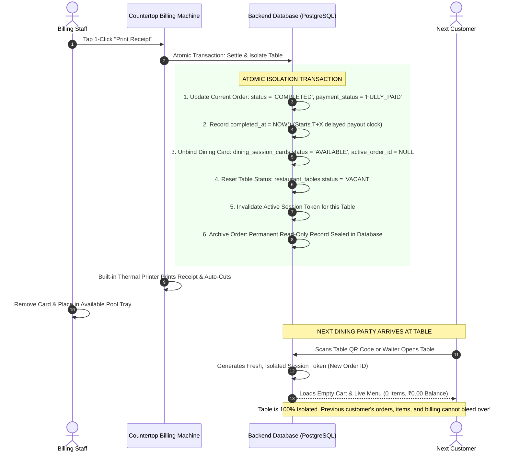

# QuickBite Custom Billing Machine: Hardware Specification & Architecture

This document details the hardware components, single-unit custom enclosure design, integrated customer mini-screen, card slot, embedded thermal printer, and table isolation lifecycle for the **QuickBite Custom Billing Machine**.

---

## 1. Device Concept & Operational Flow

> [!IMPORTANT]
> **Single Unified Custom Device (Not Two Separate Machines):**
> The **Customer Mini Screen**, the **Card Ingestion Slot**, and the **Thermal Receipt Printer** are engineered directly into **ONE single custom-designed physical machine**. It is not a fragmented set of separate external peripherals. 

The custom machine sits on the restaurant billing counter facing the customer, connected via USB or Local Network to the billing staff's POS screen (the QuickBite Restaurant B2B Portal running on the counter computer or tablet).

```text
1. Food Serving Time: Waiter Hands Physical Dining Session Card to Customer (e.g. Card #07)
   ↓
2. Customer Finishes Meal: Hands Card at Billing Counter
   ↓
3. Billing Staff Inserts Card into the Custom Machine's Integrated Card Slot
   ↓
4. Machine Reads Card UID & Instantly Synchronizes:
   • Staff POS Screen: Full operational breakdown, item management controls ([Void], [Qty Edit], [Add Item])
   • Machine's Built-in Customer Mini Screen: Displays complete itemized food list, unit prices, subtotal, GST, paid online, and balance to pay
   ↓
5. Staff Manages Any Item Corrections (Unserved dishes voided with mandatory Reason Code & Audit Log)
   • Customer Mini Screen updates dynamically in real-time
   ↓
6. Customer Settles Payment Directly with Restaurant (Cash, Card Machine, or Restaurant's Own Razorpay/UPI)
   (Note: In-venue payments flow 100% directly to the restaurant partner)
   ↓
7. Staff 1-Tap "Print Receipt" on Staff POS:
   • This EXACT Custom Machine Prints Final Itemized Tax Invoice from its Built-in Thermal Printer & Auto-Cuts Paper
   • Payment & Order are Marked COMPLETED (Anchors T+X Payout Clock for any online pre-booked food)
   ↓
8. Strict Table Isolation:
   • Table Session is Terminated & Table Status Resets to VACANT
   • Previous Order is Permanently Sealed & Archived (Zero bleed-over to next customer)
   • Card is Unlinked & Returned to Available Pool Tray for Reuse
```

---

## 2. Hardware Bill of Materials (BOM) for the Custom Machine

The custom-designed machine integrates all billing, display, and printing mechanisms inside one cohesive chassis:

| Subsystem | Component Description | Recommended Model / Specification | Integration within Custom Machine |
|---|---|---|---|
| **Embedded Compute** | Single Board Computer / Controller Board | **Option A (Maker/Custom):** Raspberry Pi 4 (2GB/4GB) or Raspberry Pi Compute Module 4 (CM4)<br>**Option B (Industrial):** Rockchip RK3566 / RK3568 Embedded Controller Board with USB host, TTL serial, and MIPI/HDMI display | Housed internally inside the custom chassis; drives the mini-screen, card reader, and thermal printer |
| **Integrated Customer Mini Screen** | Front-Facing Customer Display | 5.0-inch to 7.0-inch IPS LCD Display (800×480 or 1024×600), $\ge 400\text{ nits}$ brightness | Flush-mounted into the front face of the custom machine facing the dining customer |
| **Integrated Card Slot** | Card Ingestion Slot & Reader | **Contact:** ISO 7816 Smart Card Reader (AU9540 / RTS5169 USB IC) with microswitch card-detect<br>**Contactless:** 13.56 MHz RFID/NFC Slot (PN532 / RC522) with optical slot sensor | Embedded into the front lower panel directly beneath the mini screen |
| **Integrated Thermal Printer** | High-Speed Embedded Thermal Printer Mechanism | 58mm or 80mm Embedded Thermal Printer Mechanism with Auto-Cutter (CSN-A2, Fujitsu FTP-628MCL, or Seiko CAPD series), 203 DPI, $\ge 150\text{mm/s}$ | Mounted directly inside the top of the custom machine; receipt feeds and cuts from the top paper mouth |
| **Host Connectivity** | High-Speed USB Device Interface / LAN / Wi-Fi | USB 2.0 Type-B/Type-C Slave + Dual-band Wi-Fi + RJ45 Ethernet | Connects the custom machine to the billing staff's counter POS computer/tablet |
| **Power Management** | DC Power Input & Internal Mini-UPS | 12V DC / 24V DC 3.0A–4.0A input + Internal 2S/3S Li-ion Battery Pack (with charging circuit) | Powers the controller, customer mini screen, and thermal auto-cutter even during power cuts |
| **Custom Enclosure** | Single Unified Custom Countertop Chassis | Custom-Molded ABS / CNC Anodized Aluminum Enclosure with front mini screen bezel, card slot, and top receipt exit | Unified physical footprint on the restaurant counter (not 2 separate devices) |

---

## 3. Physical Layout & Dual-Screen Architecture

```text
┌────────────────────────────────────────────────────────────────────────────────────────┐
│                        RESTAURANT CASHIER & COUNTERTOP SETUP                           │
│                                                                                        │
│   [STAFF POS SCREEN]                       [QUICKBITE CUSTOM BILLING MACHINE]          │
│   (Counter Computer / Tablet)              (Single Unified Custom Countertop Unit)     │
│   ┌──────────────────────────────────┐     ┌────────────────────────────────────────┐  │
│   │ Table: Table 04 | Card: #07      │     │  TOP: [RECEIPT AUTO-CUT EXIT MOUTH]    │  │
│   │ -------------------------------- │     │  ====================================  │  │
│   │ 2x Chicken Biryani    [Edit][🗑️] │     │                                        │  │
│   │ 4x Butter Naan        [Edit][🗑️] │     │  FRONT CUSTOMER MINI SCREEN:           │  │
│   │ 2x Mint Lime Juice    [Edit][🗑️] │     │  ┌──────────────────────────────────┐  │  │
│   │ -------------------------------- │     │  │ Table 04 - Order Summary         │  │  │
│   │ [+ Add Item]  [Audit History 📜] │     │  │ -------------------------------- │  │  │
│   │ -------------------------------- │     │  │ 2x Chicken Biryani       ₹440.00 │  │  │
│   │ Total Bill:              ₹756.00 │     │  │ 4x Butter Naan           ₹160.00 │  │  │
│   │ Already Paid (App):     -₹400.00 │     │  │ 2x Mint Lime Juice       ₹120.00 │  │  │
│   │ Need to Pay:             ₹356.00 │     │  │ -------------------------------- │  │  │
│   │                                  │     │  │ Subtotal:                ₹720.00 │  │  │
│   │  ┌────────────────────────────┐  │     │  │ GST (5%):                ₹ 36.00 │  │  │
│   │  │   [ PRINT RECEIPT ] (1)    ├──┼────►│  │ Total Bill:              ₹756.00 │  │  │
│   │  └────────────────────────────┘  │     │  │ Already Paid (App):     -₹400.00 │  │  │
│   └──────────────────────────────────┘     │  │ BALANCE TO PAY:          ₹356.00 │  │  │
│                                            │  └──────────────────────────────────┘  │  │
│                                            │                                        │  │
│                                            │  INTEGRATED FRONT CARD SLOT:           │  │
│                                            │  [ ====== [DINING CARD #07] ====== ]   │  │
│                                            └────────────────────────────────────────┘  │
│                                            * ONE CUSTOM MACHINE HOUSING BOTH THE       │
│                                              CUSTOMER MINI SCREEN & THERMAL PRINTER!   │
└────────────────────────────────────────────────────────────────────────────────────────┘
```

### 3.1 Customer Mini-Screen Display (Food List & Financials)
- **Itemized Dish Transparency:** Customers clearly see the **full ordered food list**—dish name, quantity, unit price, and line total—along with the subtotal, GST taxes, advance online payments, and remaining balance to pay.
- **Dynamic Real-Time Sync:** If billing staff adjusts quantities or voids an item at the counter, the custom machine's mini-screen updates **instantly in real time** so the diner sees the exact adjusted bill before tendering payment.

### 3.2 Billing Staff Order Item Management & Audit Log Controls
Billing staff can manage active table items directly on the counter POS prior to printing the final receipt:
1. **Item Actions Supported:**
   - **Void Item (Cancel Dish):** Remove an erroneously punched or unserved dish.
   - **Adjust Quantity:** Increase or decrease item count (e.g. from 4 naans to 2 naans).
   - **Add Item:** Punch an additional item requested by diners at checkout (e.g. bottled water, takeaway dessert).
2. **Mandatory Audit Trail Enforcement:**
   To eliminate cashier fraud, shrinkage, or bill tampering:
   - Any item removal, cancellation, or quantity decrease requires a **Mandatory Reason Code** (e.g. `NOT_SERVED`, `CUSTOMER_REJECTED`, `KITCHEN_SPILLAGE`, `WRONGLY_PUNCHED`).
   - If the dish was already dispatched to the kitchen (KOT printed), voiding requires **Manager PIN Authorization**.
   - Every change writes an immutable audit record to `order_item_audit_logs` capturing: Staff User ID, Dish Name, Old Qty, New Qty, Delta ₹ Amount, Reason Code, and Manager Approver.
   - The staff screen has an `[Audit History 📜]` button allowing managers to inspect all past modifications on the ticket.

### 3.3 Payment Settlement & 1-Tap Print
1. **Customer In-Venue Payment:** Customer pays the net balance to the restaurant (Cash, restaurant card machine, or restaurant's own Razorpay/UPI setup).
2. **Staff 1-Tap "Print Receipt":** Staff taps 1 button on their POS screen. This custom machine immediately prints the receipt from its integrated printer mouth, cuts the paper, updates order and payment to `COMPLETED`, and isolates the table for the next customer.

---

## 4. Strict Table Isolation Lifecycle

To ensure that the next customer dining at that table has an entirely clean, isolated session without any bleed-over from the previous customer:



### Table Isolation Rules:
1. **Zero State Bleed:** When an order transitions to `COMPLETED`, its active association with `table_id` is severed. Querying active orders for that table returns `NULL`.
2. **Read-Only Archive:** Once marked `COMPLETED`, line items and bill amounts cannot be altered, appended to, or deleted.
3. **Fresh Session Generation:** The next customer scanning the table QR code or seated by staff receives a brand-new cryptographic session and a new `order_number` (`ORD-xxxxx`).
4. **Card Reusability:** The physical card is returned to `AVAILABLE` status in the restaurant's card inventory tray, ready to be assigned to any future table without retaining historical data.

---

## 5. Printed Thermal Receipt Format (80mm ESC/POS)

```text
+------------------------------------------+
|            TANDOOR NIGHTS RESTAURANT     |
|       124 MG Road, Indiranagar, Bengaluru|
|     GSTIN: 29AAAAA0000A1Z5 | FSSAI: 1122 |
|------------------------------------------|
| Date: 17/11/2026 14:15     Table: Table 04|
| Order: ORD-84920            Card: CARD-07|
| Cashier: Staff Member                    |
|------------------------------------------|
| Item                 Qty    Price   Total|
|------------------------------------------|
| Chicken Biryani        2   220.00  440.00|
| Butter Naan            4    40.00  160.00|
| Mint Lime Juice        2    60.00  120.00|
|------------------------------------------|
| Subtotal                         ₹ 720.00|
| CGST (2.5%)                      ₹  18.00|
| SGST (2.5%)                      ₹  18.00|
| Total Bill Amount                ₹ 756.00|
|------------------------------------------|
| Advance Online Paid (App)       -₹ 400.00|
| Net Amount Paid at Counter       ₹ 356.00|
| Balance Due                      ₹   0.00|
|------------------------------------------|
| Status: FULLY PAID & COMPLETED           |
|------------------------------------------|
|      THANK YOU FOR DINING WITH US!       |
|          Powered by QuickBite            |
+------------------------------------------+
[AUTO-CUT PAPER]
```

---

## 6. Color Printing & Table QR / Dining Card Generation Upgrade

To allow restaurant managers to print **Table QR Codes** and **Physical Dining Session Cards** in vibrant full color directly from this machine without needing external printing vendors, the machine incorporates a **Dual-Mechanism Print Architecture**:

```text
┌────────────────────────────────────────────────────────────────────────┐
│             DUAL-MECHANISM PRINT ARCHITECTURE IN ONE CHASSIS           │
│                                                                        │
│   MECHANISM A: Front Receipt Printer                                   │
│   • Technology: Monochrome Direct Thermal (80mm roll, 203 DPI)         │
│   • Output: Customer dining bills & GST tax invoices                   │
│   • Speed: < 1 second per bill, zero ink/ribbon cost                   │
│                                                                        │
│   MECHANISM B: Rear/Internal Color Card & QR Print Engine              │
│   • Technology: Direct-to-Card (DTC) Dye-Sublimation / Thermal Transfer│
│   • Resolution: 300 DPI edge-to-edge full-color (16.7M colors)         │
│   • Consumables: Compact replaceable YMCKO full-color ribbon cartridge │
│   • Outputs:                                                           │
│     1. Physical PVC Dining Session Cards (CR-80 RFID/NFC cards)        │
│     2. Table QR Tent Cards / Acrylic Standee Inserts                   │
│     3. Heavy-Duty Laminated Table QR Stickers                          │
│   • Integrated RFID Encoder: Automatically writes table binding & UID  │
└────────────────────────────────────────────────────────────────────────┘
```

### 6.1 What Hardware Updates are Needed Inside the Machine?
1. **DTC Thermal Transfer Print Head:** A compact 300 DPI dye-sublimation print head installed along the internal card transport path.
2. **YMCKO Ribbon Cartridge Bay:** A snap-in slot under the top maintenance hatch for a miniature YMCKO (Yellow, Magenta, Cyan, Black, Overlay) color ribbon.
3. **Card Feeder / Reversible Transport Rollers:** Motorized bi-directional rollers in the rear slot allowing blank PVC cards (or synthetic QR cards) to pass under the color print head, receive the overlay protective coat, encode the RFID chip, and eject.
4. **Firmware & Driver Pipeline:** Embedded ESC/POS driver for front thermal receipts, paired with a card rendering engine (CUPS / raster image processor) for 300 DPI CMYK color dithering on cards.

---

## 7. QuickBite Brand Identity & Physical Placement Guidelines

To establish a premium, cohesive, and instantly recognizable brand aesthetic on the custom machine:

| Touchpoint | Placement Location | Branding Specifications |
|---|---|---|
| **1. Primary Hardware Badge** | Front top of display bezel (centered) | Laser-etched or brushed metallic silver **QuickBite** wordmark with signature leaf/bite emblem ($\approx 45\text{mm} \times 12\text{mm}$). |
| **2. Signature LED Light Accent** | Aerodynamic side curves, front indicator, and card slot edge | **QuickBite Cyan/Electric Blue** LED glow (`#00D2FF` / `#0084FF`). Breaths softly when idle, solid blue during card read, pulse green on bill completion. |
| **3. Customer Mini-Screen UI** | Top navigation bar on customer LCD | Deep navy blue / teal banner (`#0D2040`) with crisp white **QuickBite** logo on top-left, `Table 04` on center, and venue brand on top-right. |
| **4. Physical Dining Session Cards** | Edge-to-edge CR-80 PVC Smart Cards | Dark titanium/sapphire background with QuickBite geometric contours, embossed card number (`CARD-07`), NFC wave symbol, and venue co-brand badge. |
| **5. Printed Table QR Cards** | High-gloss waterproof acrylic standee inserts | Clean white & electric cyan border, bold **QuickBite "Scan to Order"** banner, central high-contrast HMAC QR code, and table number badge. |
| **6. Thermal Receipt Header & Footer**| Top & Bottom of thermal paper | Centered QuickBite monochrome logo header stamp, followed by restaurant legal details; footer reads: `Powered by QuickBite • www.quickbite.in`. |

---

## 8. AI / GPT Image Generation Prompts (Text-to-Image / 3D Render)

Use the following tailored prompts in **Midjourney v6**, **ChatGPT (DALL-E 3)**, or **Flux.1** to generate hyper-realistic, studio-grade 3D renders matching the design aesthetic of your prototype with proper QuickBite branding and color card printing:

### Prompt 1: Front 3/4 Perspective Studio Product Shot (Primary Display & Card Showcase)
```text
Industrial design studio photography of a premium all-in-one restaurant countertop billing machine named "QuickBite", sleek dark titanium and matte slate-gray finish with soft cyan LED accent lines. The machine features an adjustable tilted front touchscreen displaying a clean customer order summary in Indian Rupees (₹) with the "QuickBite" logo in the top nav bar. From the lower front slot, an itemized paper tax invoice receipt is smoothly printing out with "Powered by QuickBite" at the bottom. Standing beside the machine on the polished marble cafe counter is a high-gloss, full-color printed Table QR acrylic standee branded with "QuickBite - Scan to Order Table 04". In the background, warm atmospheric restaurant bokeh lighting. Photorealistic 8k, Octane Render, clean commercial product shot, Apple-like industrial design. --ar 16:9 --style raw --v 6.0
```

### Prompt 2: Dual-Angle Operator Side Showing Color Card Printing & Insertion
```text
Professional 3D CAD product render of the custom "QuickBite" smart billing machine shown from the rear operator perspective. A human hand is inserting a sleek, custom-designed full-color printed PVC dining session card with an embedded gold chip and vibrant QuickBite teal-and-navy branding into an illuminated horizontal card slot with a crisp cyan LED guide light. The machine chassis is seamless dark gunmetal ABS with subtle chamfered corners. In the foreground, two newly printed full-color dining cards and a color table QR tent card lie neatly on the counter, showing pristine edge-to-edge dye-sublimation print quality. Sharp focus, studio softbox lighting, high-end retail POS hardware visualization, 8k resolution. --ar 16:9 --v 6.0
```

### Prompt 3: Detailed Exploded / Feature Callout Hero View
```text
A commercial hero shot of the QuickBite unified countertop POS billing terminal on a luxury wooden restaurant counter. The machine has an embossed metallic "QuickBite" logo centered above its 7-inch sharp color customer display showing Indian Rupee pricing (₹440, ₹160, ₹756). An integrated front auto-cutter thermal printer is feeding an official printed tax invoice. On the side, an illuminated card slot holds a customized NFC smart card with QuickBite branding. Next to it rests a freshly printed colorful Table QR tent card. Clean aesthetic, soft ambient shadows, depth of field, hyper-detailed textures, brushed metal and premium matte plastic, raytraced reflections. --ar 16:9 --v 6.0
```

