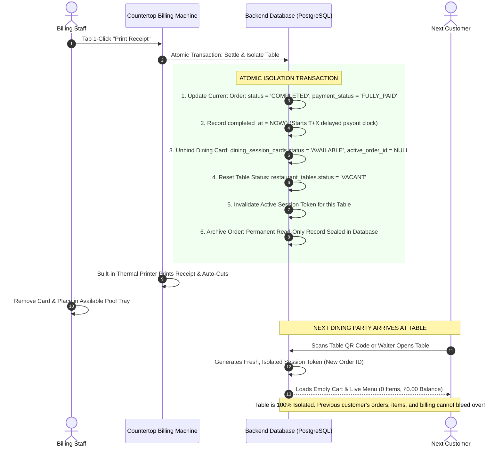

# QuickBite Countertop Billing Machine: Hardware Specification & Architecture

This document details the hardware components, dual-screen setup, card insertion mechanism, and table isolation lifecycle for the **QuickBite Countertop Billing Machine**.

---

## 1. Device Concept & Operational Flow

The **QuickBite Countertop Billing Machine** is a dedicated billing terminal placed at the restaurant cash counter. It features an integrated dining card reader, a staff display, a mini customer-facing display, and an embedded thermal receipt printer.

```text
1. Waiter Serves Food → Hands Physical Dining Card to Customer (e.g. Card #07)
   ↓
2. Customer Finishes Meal → Hands Dining Card at the Billing Counter
   ↓
3. Billing Staff Inserts Card into the Machine's Card Slot
   ↓
4. Bill Instantly Populates on Both Displays:
   • Staff Screen: Full itemized dishes, prices, taxes, advance paid online, balance to collect
   • Customer Mini Screen: Clean summary of food total, advance paid, and net amount to pay
   ↓
5. Customer Pays Normally (Cash, Restaurant's Own Card POS, or Restaurant's Own Razorpay/UPI Setup)
   (Note: In-venue food payment goes directly to the restaurant; QuickBite does not intercept counter payments)
   ↓
6. Staff 1-Tap "Print Receipt":
   • Machine Prints Final Itemized Tax Invoice / Receipt via Built-in Thermal Printer
   • Payment is Marked COMPLETED
   • Order is Marked COMPLETED (Anchors T+X Payout Clock for any online pre-booked meals)
   ↓
7. Strict Table Isolation:
   • Table Session is Terminated & Table Status Resets to VACANT
   • Previous Order is Permanently Sealed & Archived
   • Table is 100% Isolated for the Next Customer (Next customer's orders cannot affect or see previous orders)
   • Card is Unlinked & Returned to Available Pool Tray
```

---

## 2. Hardware Bill of Materials (BOM)

| Subsystem | Component Description | Recommended Model / Specification | Purpose |
|---|---|---|---|
| **Core Compute** | Single Board Computer (SBC) / Motherboard | **Option A (Custom/Maker):** Raspberry Pi 4 Model B (4GB) or Raspberry Pi 5<br>**Option B (Commercial POS):** Rockchip RK3568 / RK3288 Quad-Core ARM board with dual display outputs (HDMI + LVDS/eDP) | Central computing unit, dual display driver, card reader daemon, thermal printer driver |
| **Staff Main Screen** | Staff-Facing Touchscreen Display | 10.1-inch or 11.6-inch IPS LCD Touchscreen (1280×800 or 1920×1080), Capacitive Touch | Main operational interface for cashier/staff to view order details and tap "Print Receipt" |
| **Customer Mini Screen** | Customer-Facing Secondary Display | 4.3-inch to 7.0-inch Mini LCD / VFD Display (800×480 or 1024×600) | Displays itemized food total, amount already paid online, and balance to pay clearly to the customer |
| **Card Reader Slot** | Physical Card Ingestion Slot | **Option A:** ISO 7816 Contact Smart Card Reader with microswitch insertion detector (AU9540 / RTS5169 USB IC)<br>**Option B:** 13.56 MHz RFID/NFC Reader Slot (PN532 / RC522) with optical slot sensor | Reads dining card UID automatically when staff inserts the card |
| **Thermal Printer** | Embedded High-Speed Thermal Receipt Printer | 58mm or 80mm Embedded Thermal Printer Mechanism with Auto-Cutter (CSN-A2, Fujitsu FTP-628, or Seiko CAPD series), USB/TTL serial, 203 DPI, $\ge 150\text{mm/s}$ | Instant receipt printing upon 1-tap staff trigger |
| **Networking** | Wi-Fi + Ethernet Dual Interface | Dual-band 2.4/5.0 GHz 802.11ac Wi-Fi + Gigabit RJ45 Ethernet port | Local network connection to QuickBite backend / local server |
| **Power Supply** | DC Power Adapter & Mini-UPS | 12V DC / 24V DC 3.0A–4.0A Power Adapter + Internal Li-ion Battery Backup (enables continuous operation during power cuts) | Powers motherboard, dual screens, and thermal auto-cutter |
| **Enclosure** | Countertop Housing | Molded ABS Plastic Countertop Kiosk Casing with front card slot, customer mini-screen bezel, top receipt mouth | Compact, durable countertop footprint |

---

## 3. Dual-Screen Interface Architecture & Item Management

```text
┌────────────────────────────────────────────────────────────────────────────────┐
│                      QUICKBITE COUNTERTOP BILLING MACHINE                      │
│                                                                                │
│   [STAFF MAIN TOUCHSCREEN]                      [CUSTOMER MINI SCREEN]         │
│   ┌──────────────────────────────────┐          ┌────────────────────────────┐ │
│   │ Table: Table 04 | Card: #07      │          │ Table 04 - Order Summary   │ │
│   │ -------------------------------- │          │ -------------------------- │ │
│   │ 2x Chicken Biryani    [Edit][🗑️] │          │ 2x Chicken Biryani ₹440.00 │ │
│   │ 4x Butter Naan        [Edit][🗑️] │          │ 4x Butter Naan     ₹160.00 │ │
│   │ 2x Mint Lime Juice    [Edit][🗑️] │          │ 2x Mint Lime Juice ₹120.00 │ │
│   │ -------------------------------- │          │ -------------------------- │ │
│   │ [+ Add Item]  [Audit History 📜] │          │ Subtotal:          ₹720.00 │ │
│   │ -------------------------------- │          │ GST (5%):          ₹ 36.00 │ │
│   │ Total Bill:              ₹756.00 │          │ Total Bill:        ₹756.00 │ │
│   │ Already Paid (App):     -₹400.00 │          │ Already Paid (App):-₹400.00│ │
│   │ Need to Pay:             ₹356.00 │          │                            │ │
│   │                                  │          │ BALANCE TO PAY:    ₹356.00 │ │
│   │  ┌────────────────────────────┐  │          └────────────────────────────┘ │
│   │  │   [ PRINT RECEIPT ] (1)    │  │                                         │
│   │  └────────────────────────────┘  │          [FRONT CARD SLOT]              │
│   └──────────────────────────────────┘          [ ==== [CARD #07] ==== ]       │
│                                                 (Microswitch Auto-Detect)      │
│   [BUILT-IN THERMAL PRINTER] -> [RECEIPT AUTO-CUT: GST TAX INVOICE]            │
└────────────────────────────────────────────────────────────────────────────────┘
```

### 3.1 Customer Mini-Screen Display (Food List & Financials)
- **Itemized Dish Transparency:** Customers clearly see the **full ordered food list**—dish name, quantity, unit price, and line total—along with the subtotal, GST taxes, advance online payments, and remaining balance to pay.
- **Dynamic Real-Time Sync:** If billing staff adjusts quantities or voids an item at the counter, the customer mini-screen updates **instantly in real time** so the diner sees the exact adjusted bill before tendering payment.

### 3.2 Billing Staff Order Item Management & Audit Log Controls
Billing staff can manage active table items directly on the countertop machine prior to printing the final receipt:
1. **Item Actions Supported:**
   - **Void Item (Cancel Dish):** Remove an erroneously punched or unserved dish.
   - **Adjust Quantity:** Increase or decrease item count (e.g. from 4 naans to 2 naans).
   - **Add Item:** Punch an additional item requested by diners at checkout (e.g. bottled water, takeaway dessert).
2. **Mandatory Audit Trail Enforcement:**
   To eliminate cashier fraud, shrinkage, or bill tampering:
   - Any item removal, cancellation, or quantity decrease requires a **Mandatory Reason Code** (e.g. `NOT_SERVED`, `CUSTOMER_REJECTED`, `KITCHEN_SPILLAGE`, `WRONGLY_PUNCHED`).
   - If the dish was already dispatched to the kitchen (KOT printed), voiding requires **Manager PIN Authorization**.
   - Every change writes an immutable audit record to `order_item_audit_logs` capturing: Staff User ID, Dish Name, Old Qty, New Qty, Delta ₹ Amount, Reason Code, and Manager Approver.
   - The staff screen has an `[Audit History 📜]` button allowing managers to inspect all past modifications on the ticket.

### 3.3 Payment Settlement & 1-Tap Print
1. **Customer In-Venue Payment:** Customer pays the net balance to the restaurant (Cash, restaurant card machine, or restaurant's own Razorpay/UPI setup).
2. **Staff 1-Tap "Print Receipt":** Staff taps 1 button. The machine prints the receipt, updates order and payment to `COMPLETED`, and isolates the table for the next customer.

---

## 4. Strict Table Isolation Lifecycle

To ensure that the next customer dining at that table has an entirely clean, isolated session without any bleed-over from the previous customer:



### Table Isolation Rules:
1. **Zero State Bleed:** When an order transitions to `COMPLETED`, its active association with `table_id` is severed. Querying active orders for that table returns `NULL`.
2. **Read-Only Archive:** Once marked `COMPLETED`, line items and bill amounts cannot be altered, appended to, or deleted.
3. **Fresh Session Generation:** The next customer scanning the table QR code or seated by staff receives a brand-new cryptographic session and a new `order_number` (`ORD-xxxxx`).
4. **Card Reusability:** The physical card is returned to `AVAILABLE` status in the restaurant's card inventory tray, ready to be assigned to any future table without retaining historical data.

---

## 5. Printed Thermal Receipt Format (80mm ESC/POS)

```text
+------------------------------------------+
|            TANDOOR NIGHTS RESTAURANT     |
|       124 MG Road, Indiranagar, Bengaluru|
|     GSTIN: 29AAAAA0000A1Z5 | FSSAI: 1122 |
|------------------------------------------|
| Date: 17/11/2026 14:15     Table: Table 04|
| Order: ORD-84920            Card: CARD-07|
| Cashier: Staff Member                    |
|------------------------------------------|
| Item                 Qty    Price   Total|
|------------------------------------------|
| Chicken Biryani        2   220.00  440.00|
| Butter Naan            4    40.00  160.00|
| Mint Lime Juice        2    60.00  120.00|
|------------------------------------------|
| Subtotal                         ₹ 720.00|
| CGST (2.5%)                      ₹  18.00|
| SGST (2.5%)                      ₹  18.00|
| Total Bill Amount                ₹ 756.00|
|------------------------------------------|
| Advance Online Paid (App)       -₹ 400.00|
| Net Amount Paid at Counter       ₹ 356.00|
| Balance Due                      ₹   0.00|
|------------------------------------------|
| Status: FULLY PAID & COMPLETED           |
|------------------------------------------|
|      THANK YOU FOR DINING WITH US!       |
|          Powered by QuickBite            |
+------------------------------------------+
[AUTO-CUT PAPER]
```
