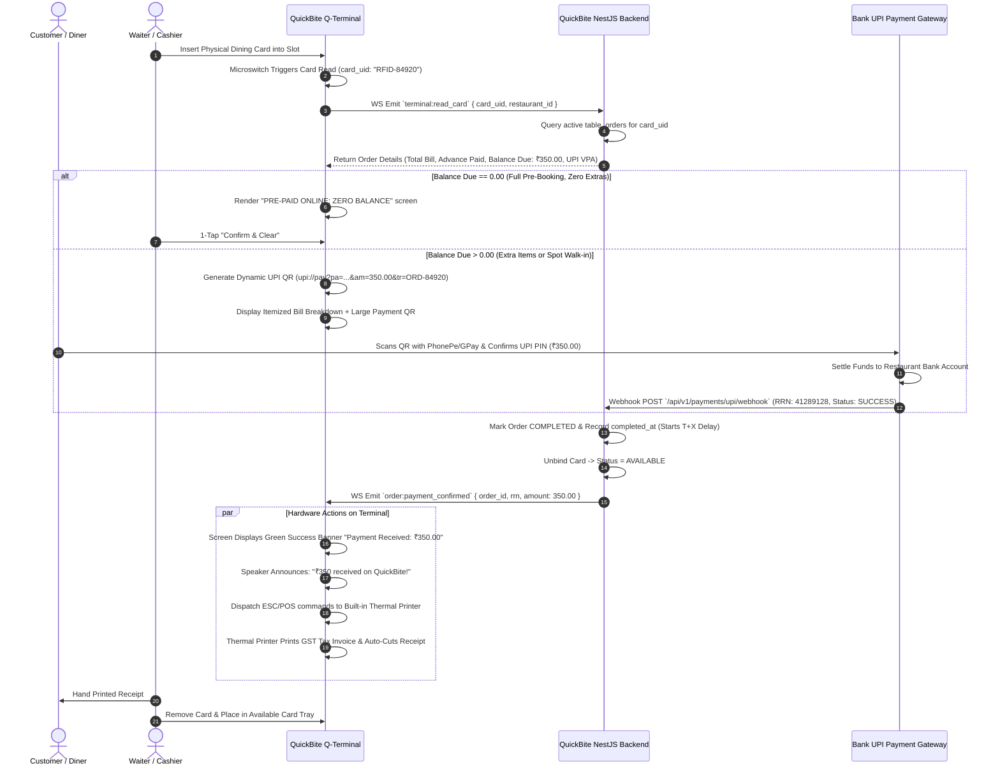

# QuickBite Q-Terminal: Hardware Device Specification & Engineering Blueprint

This document details the complete hardware engineering specifications, component Bill of Materials (BOM), system architecture, electrical design, and software integration for the **QuickBite Q-Terminal**—the custom countertop smart billing, card reading, UPI payment, and receipt printing device.

---

## 1. Device Overview & Core Functional Role

The **QuickBite Q-Terminal** is an all-in-one countertop point-of-sale terminal positioned at restaurant billing counters and service stations. It automates the conclusion of a dining session through a physical card ingestion and dynamic payment pipeline.

### Operational Sequence
```text
1. Diner/Waiter Inserts Dining Session Card into Terminal Slot
   ↓
2. Terminal Reads Card UID & Fetches Order from QuickBite Backend
   ↓
3. Screen Displays Itemized Bill (Food + Taxes, Already Paid Online Amount, Net Need-to-Pay Balance)
   ↓
4. If Need-to-Pay > ₹0.00: Screen Displays Dynamic Restaurant UPI Payment QR Code
   ↓
5. Customer Scans QR with any UPI App (GPay, PhonePe, Paytm, BHIM) & Completes Payment
   ↓
6. Backend Receives Bank Payment Webhook & Emits WebSocket Event to Terminal
   ↓
7. Terminal Triggers Audible Voice Announcement ("₹X received on QuickBite")
   ↓
8. Integrated Thermal Printer Automatically Cuts & Prints Official GST Tax Invoice Receipt
   ↓
9. Dining Card Unbinds to AVAILABLE Status & Table Status Resets to VACANT
```

---

## 2. Hardware Bill of Materials (BOM)

| Subsystem | Component Description | Recommended Model / Specification | Purpose |
|---|---|---|---|
| **Core Compute** | Single Board Computer (SBC) / Embedded Motherboard | **Option A (Custom/Maker):** Raspberry Pi 4 Model B (4GB) or Raspberry Pi 5<br>**Option B (Industrial):** Rockchip RK3568 / RK3566 Quad-Core Cortex-A55 @ 2.0GHz, 4GB LPDDR4, 32GB eMMC | Central OS execution, display driver, hardware daemon, WebSocket client |
| **Storage** | High-Endurance Storage | 32GB/64GB Industrial MicroSD (A2 V30) or onboard eMMC 5.1 / M.2 NVMe SSD | Operating system, offline buffer cache, kiosk runtime |
| **Display** | Customer-Facing Color Touchscreen | 8.0-inch to 10.1-inch IPS LCD Display, 1280×800 or 1920×1080 resolution, $\ge 400\text{ nits}$, Capacitive Multi-Touch (I2C/USB GT911 controller) | High-contrast display of itemized bill, dynamic UPI QR code, and payment confirmation |
| **Card Reader** | Contact Smart Card / RFID Hybrid Reader | **Slot Reader:** ISO 7816 Contact IC Chip Reader (Alcor Micro AU9540 or Realtek RTS5169 USB controller) with microswitch card-insertion detection.<br>**Contactless Reader:** 13.56 MHz NXP PN532 or ACR122U NFC/RFID module | Reads physical dining card UID on insertion or tap |
| **Printer Mechanism**| Embedded High-Speed Thermal Receipt Printer | 58mm or 80mm Thermal Printer Mechanism (CSN-A2, Fujitsu FTP-628MCL, or Seiko CAPD245/345) with auto-cutter, USB/TTL interface, 203 DPI, $\ge 150\text{mm/s}$ speed | Automated printing of GST tax invoice receipts immediately upon payment confirmation |
| **Audio Module** | Class-D Audio Amplifier & Speaker | 3W–5W 4Ω/8Ω Full-Range Magnetic Speaker + MAX98357A I2S or PCM2704 USB DAC | Voice announcement of received payments (Soundbox function) and system chimes |
| **Networking** | Wi-Fi + Ethernet Dual Interface | Dual-band 2.4/5.0 GHz 802.11ac Wi-Fi + Gigabit 10/100/1000 Mbps RJ45 Ethernet port | Real-time WebSocket connection to QuickBite backend |
| **Cellular Backup** | 4G LTE IoT Modem (Optional / Fallback) | Quectel EC25-E or SIMCom A7670C 4G Cat-1/Cat-4 mini-PCIe/USB modem with Nano-SIM slot | Uninterrupted network failover during venue broadband outages |
| **Power Supply** | Main DC Power Supply Unit | 12V DC / 24V DC @ 4.0A Power Adapter (24V recommended for high-speed 80mm thermal auto-cutter) | Main line power |
| **Battery Backup** | Internal Mini-UPS / Li-Ion Battery Pack | 2S or 3S Li-ion Battery pack (7.4V / 11.1V 3000mAh–5000mAh) with BMS and auto-switch circuit | 3–4 hours of continuous operational runtime during power shedding |
| **Enclosure** | Countertop Ergonomic Casing | Molded ABS-PC Flame-Retardant Plastic Casing with front card slot, top paper feed, rubber anti-slip feet | Industrial durability in humid/greasy restaurant environments |

---

## 3. Dynamic UPI Payment QR Code Standard

The terminal displays an NPCI-compliant **Dynamic Bharat QR / UPI QR Code**. Unlike static QR stickers where diners manually type amounts, the Q-Terminal dynamically encodes the restaurant's merchant credentials and exact outstanding balance.

### NPCI UPI URI Specification
$$\text{URI} = \texttt{upi://pay?pa=\{VPA\}\&pn=\{NAME\}\&mc=\{MCC\}\&tr=\{TXN\_REF\}\&tn=\{NOTE\}\&am=\{AMOUNT\}\&cu=INR}$$

### Parameter Definition
| Parameter | Value in QuickBite | Description |
|---|---|---|
| `pa` | `restaurants.upi_vpa` | Restaurant's registered merchant VPA (e.g. `quickbite.annapoorna@icici`) |
| `pn` | `restaurants.brand_name` | Legal or display brand name of the restaurant (e.g. `Hotel Annapoorna`) |
| `mc` | `5812` | Mandatory Merchant Category Code for Restaurants & Food Service |
| `tr` | `table_orders.order_number` | Unique alphanumeric order tracking reference (e.g. `ORD-84920`) |
| `tn` | `QuickBite Bill Table {num}` | Transaction note visible in customer's payment app |
| `am` | `table_orders.balance_due_amount` | **Exact Need-to-Pay amount** in Indian Rupees formatted to 2 decimals (e.g. `350.00`) |
| `cu` | `INR` | Currency identifier (Strictly Indian Rupees) |

> [!IMPORTANT]
> Because `am` (amount) is dynamically hardcoded into the QR code, the customer's UPI app (Google Pay, PhonePe, Paytm, BHIM) **locks the payment amount**. Diners cannot accidentally or intentionally pay an incorrect figure.

---

## 4. Hardware System Block Diagram

```text
┌─────────────────────────────────────────────────────────────────────────────┐
│                           QUICKBITE Q-TERMINAL                              │
│                                                                             │
│  ┌───────────────────────┐             ┌─────────────────────────────────┐  │
│  │ 8" - 10.1" IPS LCD    │             │  Contact/NFC Card Reader Slot   │  │
│  │ Touchscreen Display   │             │  (ISO 7816 / Mifare 13.56 MHz)  │  │
│  │ (Dynamic UPI QR Code) │             │  (Microswitch Insert Detect)    │  │
│  └───────────▲───────────┘             └────────────────┬────────────────┘  │
│              │ HDMI/MIPI-DSI                            │ USB/UART          │
│              │                                          ▼                   │
│  ┌───────────┴──────────────────────────────────────────┴────────────────┐  │
│  │                 Core Processing Motherboard                           │  │
│  │                 (Rockchip RK3568 / Raspberry Pi 4/5)                  │  │
│  │                 Embedded Linux / Android AOSP Kiosk OS                │  │
│  └───────────┬──────────────┬──────────────┬─────────────┬───────────────┘  │
│              │ USB/TTL      │ I2S/DAC      │ RJ45/WiFi   │ GPIO             │
│              ▼              ▼              ▼             ▼                  │
│  ┌────────────────────┐ ┌───────────────┐ ┌───────────┐ ┌────────────────┐  │
│  │ 58/80mm High-Speed │ │ 5W Class-D    │ │ Fast LAN  │ │ Card Eject /   │  │
│  │ Thermal Printer &  │ │ Audio Speaker │ │ / 4G LTE  │ │ Status LEDs    │  │
│  │ Auto-Cutter        │ │ (Voice Alerts)│ │ Modem     │ │ (Green/Amber)  │  │
│  └────────────────────┘ └───────────────┘ └───────────┘ └────────────────┘  │
│                                 ▲                                           │
│                                 │ 12V / 24V DC                              │
│  ┌──────────────────────────────┴────────────────────────────────────────┐  │
│  │ Power Management Unit (PMU) & 3S Li-ion Battery Mini-UPS Backup       │  │
│  └───────────────────────────────────────────────────────────────────────┘  │
└─────────────────────────────────────────────────────────────────────────────┘
```

---

## 5. Software Architecture & Device Runtime

The terminal software runs in dedicated, locked **Single-App Kiosk Mode**.

### 5.1 Software Stack
1. **Operating System:** Hardened Linux (Armbian/Debian with X11/Wayland kiosk) or Android 12 AOSP with Device Owner provisioning.
2. **Device Hardware Bridge Daemon (Node.js / Rust):**
   - **`card-reader-service`:** Monitors USB/serial card slot. Emits `card:inserted` with `card_uid` and `card:removed`.
   - **`printer-service`:** Communicates directly with the thermal printer mechanism using ESC/POS binary streams (`node-escpos` / `libusb`). Handles paper cut and sensor status.
   - **`audio-service`:** Plays payment chimes and synthesizes voice alerts using local offline TTS (`flite` / `espeak-ng` / pre-rendered audio buffers).
3. **Frontend Terminal UI:**
   - Lightweight React / Vite SPA running in full-screen Chromium with `--kiosk --noerrdialogs --disable-pinch`.
   - Connected via persistent WebSocket (Socket.IO client) with TLS encryption to the QuickBite NestJS backend.

---

## 6. End-to-End Payment & Thermal Print Pipeline



---

## 7. Thermal Receipt Layout Specification (80mm ESC/POS)

```text
+------------------------------------------+
|            TANDOOR NIGHTS RESTAURANT     |
|       124 MG Road, Indiranagar, Bengaluru|
|     GSTIN: 29AAAAA0000A1Z5 | FSSAI: 1122 |
|------------------------------------------|
| Date: 17/11/2026 14:15     Table: Table 04|
| Order: ORD-84920            Card: CARD-07|
| Cashier: Ramesh K                        |
|------------------------------------------|
| Item                 Qty    Price   Total|
|------------------------------------------|
| Chicken Biryani        2   220.00  440.00|
| Butter Naan            4    40.00  160.00|
| Mint Lime Juice        2    60.00  120.00|
|------------------------------------------|
| Subtotal                         ₹ 720.00|
| CGST (2.5%)                      ₹  18.00|
| SGST (2.5%)                      ₹  18.00|
| Total Bill Amount                ₹ 756.00|
|------------------------------------------|
| Advance Online Paid (App)       -₹ 400.00|
| Net Amount Paid via UPI Counter  ₹ 356.00|
| Balance Due                      ₹   0.00|
|------------------------------------------|
| Bank UPI Ref (RRN): 412891289412        |
| Payment Mode: Dynamic UPI QR (PhonePe)   |
| Status: FULLY PAID & SETTLED             |
|------------------------------------------|
|      THANK YOU FOR DINING WITH US!       |
|          Powered by QuickBite            |
+------------------------------------------+
[CUT PAPER]
```

---

## 8. Environmental, Electrical & Safety Certifications

1. **Operating Temperature:** $0^\circ\text{C}$ to $50^\circ\text{C}$ (handles hot restaurant kitchens and counter ambient heat).
2. **Relative Humidity:** $10\%$ to $90\%$ non-condensing (spill-resistant sealed front bezel).
3. **Power Surge Protection:** Built-in varistor and TVS diode on the 12V/24V DC input barrel jack to withstand voltage spikes common in commercial Indian power grids.
4. **Standard Compliance:** CE, FCC Class B, and BIS (Bureau of Indian Standards) IS 13252 for information technology equipment.
